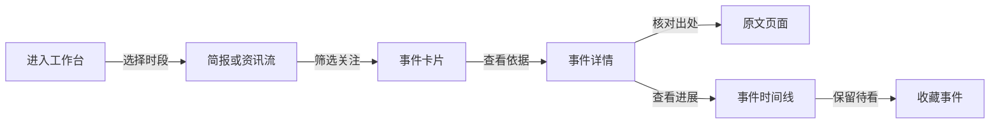
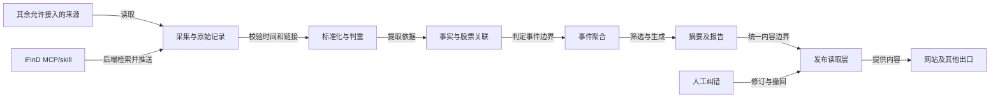

# StockHOT 产品需求文档

版本：0.2。日期：2026-10-17。
状态：评审稿。产品名尚未定稿。
配套文件：requirements-analysis.md。
本稿承接其中的 R01 至 R13。

## 1. 产品定义

StockHOT 是个人股票资讯工作台。
用户通过事件卡片发现重点。
用户通过原文与时间线核验消息。

首版覆盖三个已确认场景。
市场暂按沪深北 A 股设计。
市场范围仍需用户确认。

## 2. 三个核心使用流程

| 场景 | 用户动作 | 系统输出 | 完成标准 |
|---|---|---|---|
| 盘前梳理 | 打开盘前简报 | 新事件、风险事件、关注变化 | 能打开重点事件的原始依据 |
| 盘中跟踪 | 查看关注及最新资讯 | 新进展、来源状态、更新时间 | 能区分新事实与重复报道 |
| 盘后复盘 | 打开盘后回顾 | 当日变化及事件时间线 | 能重建当时已知的信息 |

## 3. 页面与信息架构

优先复用 AIHOT 的现有页面。
以下为产品页面，不承诺现成路由。

| 页面 | 主要内容 | 核心动作 |
|---|---|---|
| 工作台 | 重点事件、最新资讯、关注变化 | 切换视图、筛选、打开事件 |
| 事件详情 | 摘要、依据、冲突、时间线 | 读原文、收藏、查看更正 |
| 股票与题材 | 关联事件及关联依据 | 添加关注、筛选时间 |
| 盘前简报 | 上次盘前截止后新增重点 | 查看事件及原文 |
| 盘后回顾 | 当日新增事实与风险变化 | 回看时间线 |
| 搜索 | 标题、摘要、股票与题材 | 按来源及时间过滤 |
| 来源状态 | 最近成功时间与当前状态 | 查看受影响内容 |
| 管理后台 | 来源、纠错、标注与成本 | 试抓、启停、合并或拆分 |

电脑端首屏展示三类信息。
顶部展示更新时间和来源状态。
主体展示事件列表。
侧栏展示个人关注与简报入口。

手机端优先显示事件列表。
筛选器折叠为单个入口。
原文按钮始终可直接访问。
首版沿用框架的视觉基础。

## 4. 事件卡片

卡片回答以下五个问题：

1. 发生了什么。
2. 为什么值得关注。
3. 原文在哪里。
4. 关联哪些股票。
5. 相比上次新增了什么。

| 字段 | 规则 |
|---|---|
| 标题 | 保留原文的事实边界 |
| 摘要 | 建议 80 至 150 个汉字 |
| 关注理由 | 独立于事实摘要展示 |
| 内容类型 | 原始披露、报道、观点或待核验 |
| 关联股票 | 代码、简称、关联依据 |
| 发布时间 | 原文时间，精度如实显示 |
| 站内更新时间 | 本站最近处理完成时间 |
| 来源数 | 报道来源数，不表示独立证实数 |
| 新进展 | 只标记新增事实 |
| 状态 | 待核验、已更正、已撤回等 |

示例为虚构内容：

> 某公司拟签订设备采购合同。  
> 原文只披露拟签订，尚未签署。  
> 关联依据：公告明确列出公司主体。  
> 关注理由：合同事项出现新进展。  
> 状态：原始披露。查看公告原文。

卡片不显示“必涨”“确定受益”等判断。
没有足够正文时，只展示标题与原文。
系统不得仅凭标题补写事实。

## 5. 内容处理流程

页面访问不触发模型调用。
外部内容一律视为待处理资料。
文章中的指令不能触发工具或操作。
付费处理复用框架的预算机制。
iFinD 配额需在后端适配器单独核对。
不得假设框架模型预算覆盖 MCP 配额。

### 同花顺资讯接入

同花顺资讯仅使用 iFinD MCP/skill。
新闻、公告、热点分别使用对应检索工具。
后端适配器通过 external 入口入库。
适配器按批准的主题与时间窗定时查询。
查询主题覆盖关注股票及市场热点。
股票关注不应成为全部检索的唯一范围。

新闻与公告支持时间范围及结果数量参数。
热点工具使用自己的时效范围参数。
字段取值、分页和截断行为需实测。
未确认的参数不能当作可用能力。
每批保存工具名、查询条件与结果上限。
保存请求时间、返回数和失败状态。
重复片段按原文标识或链接归并。
无稳定标识时，记录指纹及待复核状态。

原始发布机构与 iFinD 通道分开记录。
iFinD 通道不能重复计为独立报道来源。
未能确认发布机构时，不宣称独立证实。
服务返回片段时，保留片段范围与出处。
缺少可追溯出处的结果进入待核验。
正文缺失不触发同花顺网页补抓。
摘要只能陈述返回片段支持的事实。

无结果仅表示本次条件未命中。
凭据失效、配额耗尽与无结果分开显示。
接口失败不回退同花顺网页爬取。
自动任务不依赖当前聊天持续运行。

## 6. 内容和时间契约

以下为逻辑字段，不是最终数据库设计。

| 对象 | 必要字段 |
|---|---|
| 来源 | 标识、栏目或检索主题、接入方式 |
| 来源权限 | 允许处理范围、凭据引用、配额 |
| iFinD 检索批次 | 工具名、条件、结果上限、请求时间 |
| iFinD 返回记录 | 返回数、原始标识、片段、失败状态 |
| 来源追溯 | 数据通道、原始发布机构、出处链接 |
| 文章 | 来源标识、原文链接、标题、作者 |
| 时间 | 原文发布时间、精度、采集时间 |
| 处理记录 | 站内发布时间、版本、失败原因 |
| 原始证据 | 允许保留的摘录、位置、内容指纹 |
| 事件 | 事件标识、主体、动作、对象、时间 |
| 股票关联 | 市场、代码、名称、依据、确认状态 |
| 事实主张 | 事实句、引用文章、支持片段 |
| 报告 | 类型、起止时间、生成版本、覆盖状态 |
| 更正 | 原版本、修订内容、原因、生效时间 |

有权限才保留正文或附件。
不能保留全文时，保存允许的摘录。
证据记录必须保留链接与内容指纹。

统一按 Asia/Shanghai 展示时间。
系统保留原始时间文本及其精度。
纯日期不能伪造为精确时刻。
未知发布时间的条目进入待核验。
待核验条目不进入实时排序。

原文时间负责描述消息的新旧。
采集时间负责描述本站何时发现。
站内发布时间负责描述何时可读。
三种时间不能相互替代。

首次导入的旧文进入历史归档。
系统不得用采集时间把旧文变成新文。
无新事实的转载不触发新进展。
更正与撤回记录保留版本时间。

## 7. 聚合与核验规则

事件按主体、动作、对象与时间判断。
同一题材不代表同一事件。
同一公司也不代表同一事件。

以下情况可以合并：

- 多家网站转载同一份公告。
- 同一事项出现可验证的后续进展。

以下情况必须分开：

- 同一公司的不同合同。
- 同一题材中的不同公司事件。
- 不同年份的相似政策。
- 未证实传闻与无关正式公告。

冲突报道可归入同一事件。
系统并列展示各方说法及出处。
模型不得把冲突压成确定结论。

跨站转载保留所有原文入口。
独立原始出处须单独计数。
未知转载关系不能声称独立证实。
人工修正的归属不得自动覆盖。

## 8. 股票关联与个人关注

股票标识采用“市场加代码”。
名称只是展示信息。
主数据需保留版本与生效日期。

| 关联类型 | 判定规则 | 首版行为 |
|---|---|---|
| 明确提及 | 原文写明代码或唯一主体 | 展示为直接关联 |
| 别名映射 | 别名能唯一匹配证券主体 | 展示映射依据 |
| 题材关联 | 原文仅涉及某类产业 | 展示题材，不推定个股 |
| 推断关联 | 模型推测产业链受益对象 | 首版不自动确认为个股 |
| 存在歧义 | 同名、简称冲突、母子公司混淆 | 标记待确认 |

一篇文章可以关联多个股票。
没有股票也可以保留政策事件。
股票代码缺失时不得编造代码。

个人关注支持股票与题材。
首版建议保存在本机。
提供导出和导入，提示本机范围。
跨设备同步属于后续范围。
收藏事件与关注股票是不同操作。

关注过滤只改变阅读范围。
它不自动提高消息可信度。
风险事件必须和正面事件同等处理。

## 9. 重点与热度

首页提供三种独立视图：

| 视图 | 排序依据 | 用途 |
|---|---|---|
| 重点事件 | 证据、相关性、增量和影响范围 | 快速梳理 |
| 最新资讯 | 可信原文时间倒序 | 盘中跟踪 |
| 原始披露 | 原始内容类型及时间 | 查阅一手依据 |

系统另保留资讯热度排序。
热度不替代内容可靠性。

AIHOT 当前热度窗口为 48 小时。
当前时间衰减半衰期为 24 小时。
这些参数是上游基线。
它们尚未通过股票资讯样本校准。
依据见需求分析中的热度实现链接。

重点筛选保留原有评分结构。
行业规则改为以下判断：

- 是否包含可追溯的新增事实。
- 是否关系关注股票或重要题材。
- 是否涉及经营、政策或风险变化。
- 是否只是重复转载或营销内容。
- 是否缺少关键出处与限定条件。

首版不拍脑袋设置新的分数门槛。
先标注样本，再校准门槛。
每次调整记录规则版本。
原始披露入口不依赖热度达标。

## 10. 简报与更新节奏

以下为待确认的产品建议。
所有时间均为北京时间。

| 项目 | 建议时间或频率 | 规则 |
|---|---|---|
| 盘前简报 | 交易日 08:00 | 窗口为上次盘前截止至本次截止 |
| 盘后回顾 | 交易日 18:00 | 窗口为当日 08:00 至 18:00 |
| 盘中采集 | 交易日 08:00 至 18:00 | 高频来源先评估每 5 分钟 |
| 其他时段 | 非上述时段 | 先评估每 30 分钟 |
| 事件列表 | 用户打开或手动刷新 | 显示结果更新时间 |

上游原生采集自适应下限为 15 分钟。
经 Jina 读取的列表下限为 60 分钟。
这些下限不代表 iFinD 服务限制。
iFinD 通过后端适配器独立排程。
盘中 5 分钟仍是待验证目标。
iFinD 需核对请求配额与服务时效。
其余来源需核对自适应任务的覆盖行为。
仅手动改间隔不能证明目标可持续。

访问频率服从来源允许范围。
不满足时效时，展示延迟状态。
首版不承诺秒级资讯。

盘后窗口与次日盘前窗口存在重叠。
两份报告服务不同的阅读场景。
已报道事件保留“已报道”标记。
没有新增事实时，不重复写成新事件。

交易日历需确定数据来源。
不能只用周一到周五替代。
节假日后的盘前覆盖整个间隔。

报告仅使用截止时刻前的可见版本。
迟到资讯进入后续报告并标明迟到。
历史报告保留当时版本。
必要更正以显式修订呈现。

报告必须区分两种结果：

- 来源正常，但没有新增重点。
- 来源缺失，当前无法完整判断。

来源缺失时允许发布不完整报告。
标题附近必须展示缺失范围。
不得用空日报暗示市场没有事件。

双时段报告属于待实现扩展。
AIHOT 的单日报时间配置不能直接替代。
实现前需核对任务与时间窗口。

## 11. 异常状态与恢复

| 状态 | 用户看到的内容 | 系统行为 |
|---|---|---|
| 无新增 | 来源正常，暂无新内容 | 保留成功检查时间 |
| iFinD 无结果 | 当前检索条件未命中 | 不推断市场没有资讯 |
| iFinD 凭据失效 | iFinD 待恢复 | 停止相关请求，不回退爬取 |
| iFinD 配额耗尽 | iFinD 检索暂停 | 按额度恢复，不回退爬取 |
| 采集失败 | 来源延迟及失败时刻 | 保留旧内容，不伪造新数据 |
| 登录失效 | 来源待恢复 | 停止依赖该凭据的任务 |
| 访问受限 | 来源不可用 | 按允许方式处理或人工恢复 |
| 正文缺失 | 标题或有出处的片段 | 仅摘要有依据片段，不补写全文 |
| 时间未知 | 发布时间待核验 | 不进入实时列表 |
| 模型失败 | 处理延迟 | 保留原文，不生成伪摘要 |
| 模型预算用尽 | 智能处理暂停 | 其他额度允许时继续基础采集 |
| 来源撤回 | 内容已撤回 | 所有衍生出口同步处理 |
| 证据冲突 | 存在不同说法 | 并列保留原始依据 |

撤回仅由明确证据或人工确认触发。
证据包括源站撤回标记和正式更正。
单次超时、403 或 404 不代表撤回。
此类情况显示原文暂不可用。
管理员复核后再决定内容状态。
首版不承诺自动发现全部源站撤回。
更正验收从系统收到明确指令时计时。
建议 5 分钟内同步全部读取出口。

过期阈值与来源频率绑定。
建议超过两个采集周期即标记延迟。
连续无新增不等于故障。
连续抓取失败才计入失败状态。

## 12. 访问、内容与成本边界

建议先在个人可访问环境运行。
公网私有部署需统一访问限制。
范围包括网页、API、RSS 和 MCP。
隐藏导航不能代替访问限制。

后台凭据不得进入前端与日志。
原文只展示允许范围内的内容。
全文关闭时，各出口都需遵守。
来源撤回不能只删除首页卡片。

每个模型任务记录用量与费用。
iFinD 请求另记额度消耗和服务状态。
实际并发与频率以当前账户权益为准。
凭据只在服务端读取，不写入产品文档。
同一处理版本的重试应复用已有结果。
预算由用户设定后启用付费任务。
系统不得自动购买数据服务。

页面响应与模型处理分别计时。
首版目标是稳定可读和信息可信。
性能数字须由试运行实测确定。

## 13. 关键验收用例

以下用例覆盖 R01 至 R13。
量化门槛采用需求分析第 10 节。

| 用例 | 对应需求 | 输入或动作 | 预期结果 |
|---|---|---|---|
| A01 | R01、R02 | 两源提供合法样本 | 各自形成可追溯资讯 |
| A02 | R04、R05 | 两源返回同一公告 | 一个事件，多个报道入口 |
| A03 | R05 | 同公司两份不同合同 | 两个事件，不误合并 |
| A04 | R03、R04 | 社区写“据传将签约” | 保留据传，不标为正式签约 |
| A05 | R03、R09 | 低热度重要原始公告 | 能在原始披露入口找到 |
| A06 | R06 | 同名公司缺少代码 | 标记歧义，不自动确定 |
| A07 | R07 | 用户关注某股票 | 仅匹配有依据的相关事件 |
| A08 | R08、R10 | 周末消息进入周一简报 | 正确覆盖，保留原文时间 |
| A09 | R02、R08 | 今天发现上月旧文 | 归档，不冒充今日新增 |
| A10 | R04、R11 | 只能读取标题 | 不生成无依据的事实摘要 |
| A11 | R08、R11 | 一家来源连续失败 | 简报标注来源缺失 |
| A12 | R08 | 全部来源正常且无重点 | 展示本轮未发现重点，区别于失败 |
| A13 | R12 | 摘要引用的原文被撤回 | 页面及衍生出口同步更新 |
| A14 | R13 | 模型预算达到上限 | 暂停付费调用，显示状态 |
| A15 | R08、R10 | 截止后到达一篇早发文章 | 标为迟到，不倒填旧报告 |
| A16 | R04、R05 | 两家报道结论相反 | 展示冲突，不生成单一结论 |
| A17 | R13 | 文章中含操作指令 | 仅当资料处理，不执行 |
| A18 | R13 | 未授权访问私有部署 | 所有读取出口均受限制 |
| A19 | R10 | 按代码、题材、来源和日期搜索 | 返回范围内结果，支持空结果 |
| A20 | R11、R12 | 原文单次超时或返回 404 | 不自动撤回，进入复核 |
| A21 | R12 | 管理员确认撤回 | 5 分钟内同步各读取出口 |
| A22 | R01、R11 | 跨越每日调度调整时刻 | 核对原生与 iFinD 各自排程 |
| A23 | R01、R13 | 同花顺资讯接入或请求失败 | 仅调用 iFinD；无网页爬取请求 |
| A24 | R04 | iFinD 只返回相关段落 | 摘要不超出片段，不声称全文 |
| A25 | R08、R11 | iFinD 返回空结果或额度错误 | 分别展示未命中与检索暂停 |
| A26 | R01、R05 | iFinD 重复返回同一原文片段 | 幂等入库，不重复计独立来源 |
| A27 | R01、R04 | iFinD 缺少原文或发布时间 | 进入待核验，不冒充实时资讯 |

来源验收至少观察 5 个交易日。
用户用独立验收样本评判重点。
一轮演示不能替代正式验收。
单源受阻只能标为部分试运行。

## 14. 实现边界与交付顺序

先复用框架现成能力。
站点内容放入 site。
行业知识放入 industry。
只有股票专项能力才新增模块。

| 顺序 | 交付内容 | 必要前提 |
|---|---|---|
| 1 | 两源接入验证与样本 | 核对 iFinD 权益；韭研公社栏目与权限 |
| 2 | 分类、摘要、聚合与原文 | 样本能形成可追溯闭环 |
| 3 | 股票关联与个人关注 | 市场范围和主数据确定 |
| 4 | 双时段报告与来源状态 | 时间窗口及日历确定 |
| 5 | 质量评测与个人试运行 | 预算和访问边界确定 |

当前不进入编码与部署。
本稿没有批准新的付费调用。
产品负责人确认待决项后再细化实施。

## 15. 交付验证状态

已验证：已按三个确认场景定义流程。
已验证：需求编号具备验收用例。
未验证：页面原型与实际交互。
未验证：iFinD 实际调用与额度。
未验证：其余采集、模型、部署与性能。
被阻塞：当前文档交付无阻塞。
来源能力证据见配套需求分析。

